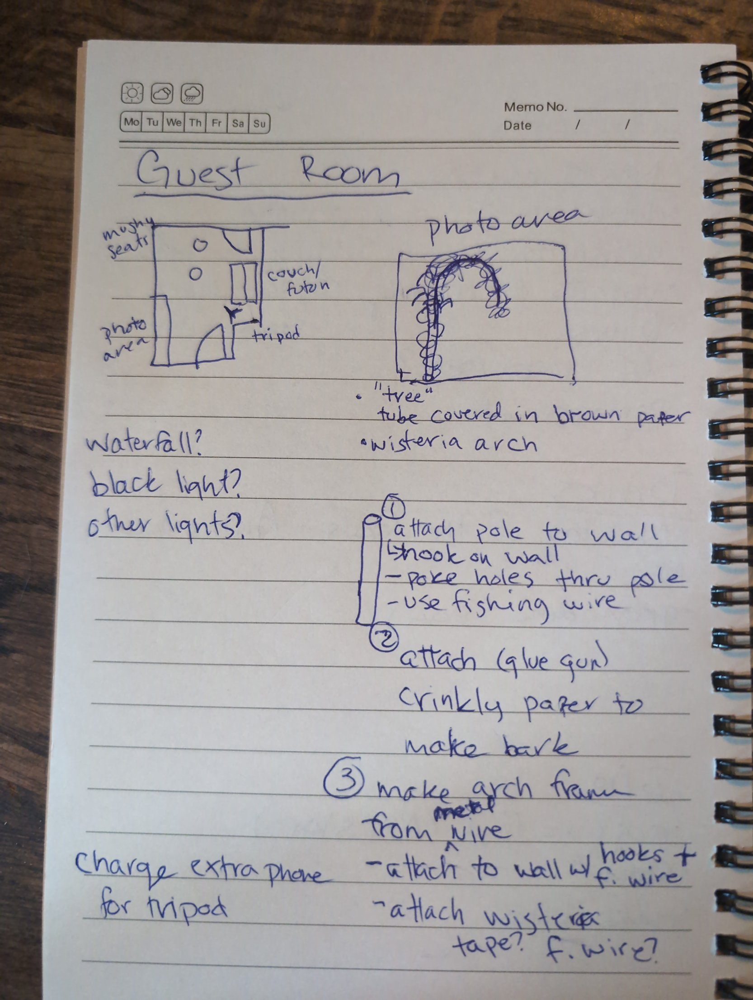
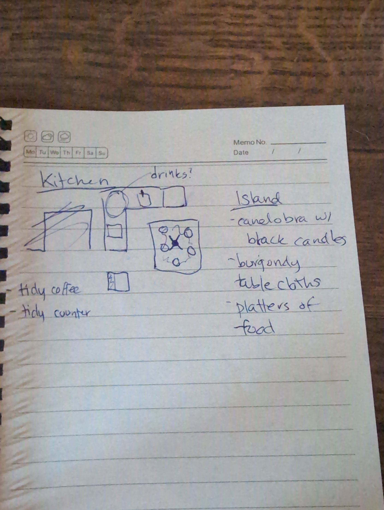
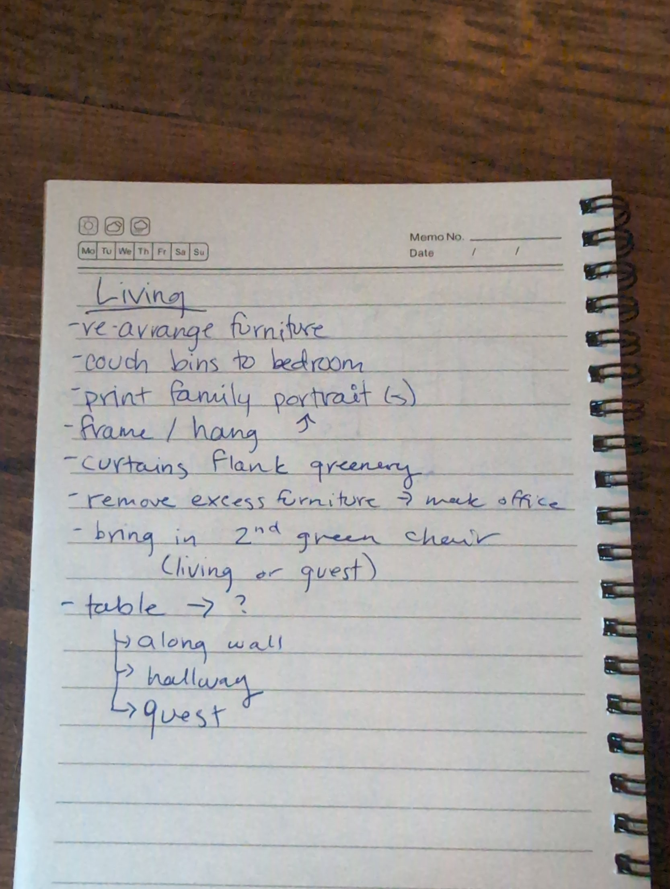
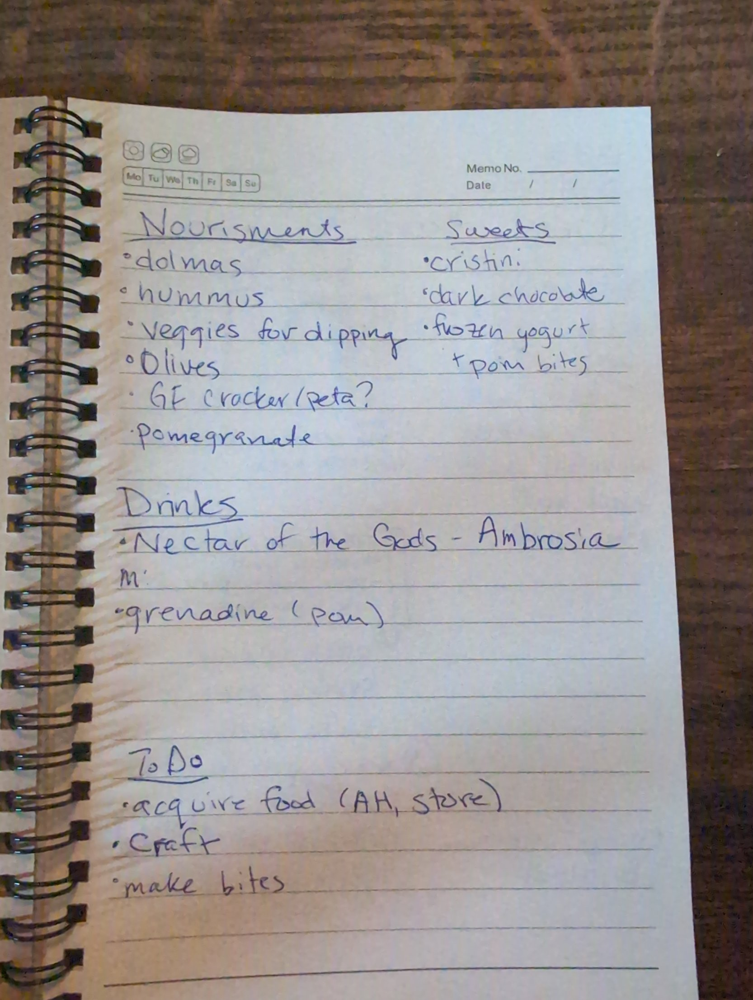

# Court Below: setup plan

This is the source for the live `/setup` checklist (see the [technical spec](tech-spec.md#setup-page-setup)). Items starting with **Decide** still need a call before they can be done.

## Friday plan

Friday covers shopping, furniture, the photo wall build and the tech rehearsal. Saturday covers the entryway, fresh food, costumes and the last touches. Suggested order for Friday:

1. **Shopping run:** the thrift store for platters, craft supplies, and the non-fresh food from Albert Heijn.
2. **Living room furniture**, while there are two of you to move things.
3. **Guest room photo wall**: the tree and the wisteria arch take the longest.
4. **Kitchen**: tidy, tablecloths and the candelabra.
5. **Frozen yogurt and pomegranate bites**, made Friday so they freeze overnight.
6. **Tech rehearsal** in the evening, while friends are over helping decorate (pizza provided), following the checklist in the [technical spec](tech-spec.md#testing-and-failure-modes).

The shopping list is grouped by store, so whoever heads out can take a whole section.

## Checklists by room

### Entryway (Saturday)

- [ ] Hang the skulls: drill a hole and hang each with finishing wire on a hook
- [ ] Add jewels to the skulls' eyes
- [ ] Pillars with faux candles
- [ ] Mist makers set up and tested
- [ ] Incense, lit away from the smoke alarm
- [ ] Clear the shoe and coat rack in the hall for guests' coats and shoes
- [ ] QR card and the Seeds rules card by the door

### Guest room: Elysium (photo booth)

The photo area runs along the wall by the door: a paper-bark tree with a wisteria arch, shot from a tripod across the room. Coats go on the hall rack, so the futon stays free.

- [ ] Tree, step 1: attach the pole to the wall (hook on the wall, holes through the pole, fishing wire)
- [ ] Tree, step 2: glue crinkly brown paper onto the pole for bark (glue gun)
- [ ] Arch, step 3: bend the frame from metal wire and hang it from wall hooks with fishing wire
- [ ] Arch: attach the wisteria (test whether tape or fishing wire holds better)
- [ ] **Decide** on lighting: black light, other lights, or a waterfall effect
- [ ] Charge the spare phone for the tripod; set the tripod across from the photo area and test the self-timer
- [ ] Mushy seats and the couch/futon tidy for sitting
- [ ] Create the shared Google Photos album with collaboration on
- [ ] Print the album's QR card and put it by the photo area

### Living room: the Court

Dark and candlelit, with family portraits and greenery. This is where the Trial happens, so it needs open floor and a clear view of the TV.

- [ ] Rearrange the furniture so the seats face the TV for the Trial
- [ ] Move the couch bins to the bedroom
- [ ] Move excess furniture out to the office
- [ ] **Decide:** the second green chair goes in the living room or the guest room
- [ ] **Decide** where the table goes: along the wall, in the hallway or in the guest room
- [ ] Print the family portrait(s), then frame and hang them
- [ ] Curtains flanking the greenery
- [ ] Speaker placed, playlist queued, volume checked from the far side of the room
- [ ] Laptop near the TV and plugged in; cast `/tv` and turn the TV brightness down
- [ ] Lamps and LED candles placed (overhead light off on Saturday)
- [ ] **Decide** where the cats stay for the night and put a sign on that door

### Kitchen: the Banquet (bar station: Mark)

The island is the banquet table: burgundy tablecloths, a candelabra with black candles in the middle, and platters of food around it. Drinks go on the counter if that's where Mark wants the bar.

- [ ] Tidy the coffee corner
- [ ] Tidy the counters
- [ ] Burgundy tablecloths on the island
- [ ] Candelabra with black candles in the middle of the island
- [ ] Platters set out around it (filled on Saturday)
- [ ] **Mark:** confirm the bar spot on the counter; set out glasses, jigger, shaker, opener and the ice bucket
- [ ] **Mark:** cocktail menu card, starring Ambrosia, the Nectar of the Gods
- [ ] **Mark:** clear fridge space for drinks
- [ ] Make the frozen yogurt and pomegranate bites (Friday)
- [ ] Rubbish bin and bottle recycling in plain sight, with spare bags

### Bathroom

- [ ] LED candle and a small decor touch
- [ ] Spare toilet paper and a fresh hand towel

### Tech and game

- [ ] App deployed and the Supabase project awake (see the spec)
- [ ] Print three QR cards, the Seeds rules card and six seed envelopes
- [ ] Rehearsal: laptop casting, host remote on your phone, two or three test phones

### Costumes

- [ ] Mark's necklace
- [ ] Mark's crown

## Shopping list

Quantities are estimates for 15 guests from 20:00 to 02:00 with no dinner; adjust to what you already have. Fresh food and ice are bought Saturday, everything else Friday.

### Drinks (Mark): Gall & Gall and Albert Heijn

- [ ] Ambrosia (Nectar of the Gods) ingredients, per Mark's recipe
- [ ] Grenadine (pomegranate)
- [ ] Red wine, 6 bottles
- [ ] White or rosé, 3 bottles
- [ ] Sparkling wine, 3 bottles (enough for the toasts at the Trial)
- [ ] Alcohol-free options: sparkling water, a mocktail base, soft drinks
- [ ] Ice, 3 bags (Saturday)
- [ ] Citrus and garnishes (Saturday)

### Food: Albert Heijn (Saturday)

Nourishments

- [ ] Dolmas
- [ ] Hummus
- [ ] Veggies for dipping
- [ ] Olives
- [ ] **Decide:** gluten-free crackers or pita
- [ ] Pomegranates (some for the bites)

Sweets

- [ ] Crostinis
- [ ] Dark chocolate
- [ ] Frozen yogurt for the pomegranate bites (Friday)

### Game and supplies: Action or HEMA (Friday)

- [ ] Red dot stickers, about 13 mm (Persephone's Seeds)
- [ ] Six small envelopes
- [ ] Card stock for QR cards and the rules card (or print at HEMA)
- [ ] A prize for Favored of Hades
- [ ] Batteries for LED and faux candles
- [ ] Dark napkins, plus spare bin bags

### Thrift store (Friday)

- [ ] Platters for the island

### Craft and decor (check what you already have)

- [ ] Pole or tube for the tree, crinkly brown paper, glue gun sticks
- [ ] Metal wire for the arch, wall hooks, fishing wire
- [ ] Wisteria garlands and tape
- [ ] Finishing wire and hooks for the skulls; jewels for their eyes
- [ ] Black candles for the candelabra
- [ ] Incense
- [ ] Burgundy tablecloths
- [ ] Materials for Mark's necklace and crown

## Layout and decor vision

Each room plays a different part of the myth: Hades' dark Court for the Trial, the Banquet on the kitchen island, and a golden Elysium for photos.

**Guest room: Elysium photo booth.** Mushy seats in one corner and the couch/futon along the opposite wall. The photo area runs along the wall by the door, with the tripod across the room facing it. On the photo wall, a pole wrapped in paper bark forms the "tree", and a wire arch of wisteria curves out from it.

**Kitchen: the Banquet.** The island is the centrepiece: burgundy tablecloths, a candelabra with black candles in the middle, platters of food around it. Drinks may go on the counter run (Mark's call). Coffee corner and counters tidied.

**Living room: the Court.** Dark and candlelit: seats and green chairs facing the TV (the Hall of Shades), family portraits on the wall, curtains flanking the greenery, excess furniture out to the office. Table placement still to decide.

**Menu and to-dos** (original notes)

## Saturday before doors

Doors open at 20:00, so everything below should be done by 19:45.

- [ ] Afternoon: fresh food from Albert Heijn; **Mark:** ice, garnishes and the last drinks run
- [ ] Afternoon: entryway (see its checklist) and finish the costumes
- [ ] 18:00: open the Supabase dashboard so the project is awake; reset the game on the host remote
- [ ] 19:00: food onto the platters; drinks chilled; ice in the bucket
- [ ] 19:30: laptop casting the Hall of Shades; QR cards at the door and on the island; seed envelopes ready
- [ ] 19:30: photo area lights on and one test shot from the tripod phone
- [ ] 19:45: overhead lights off, candles on, mist makers on, incense lit, playlist playing
- [ ] 19:45: cats settled in their room with the door sign up
