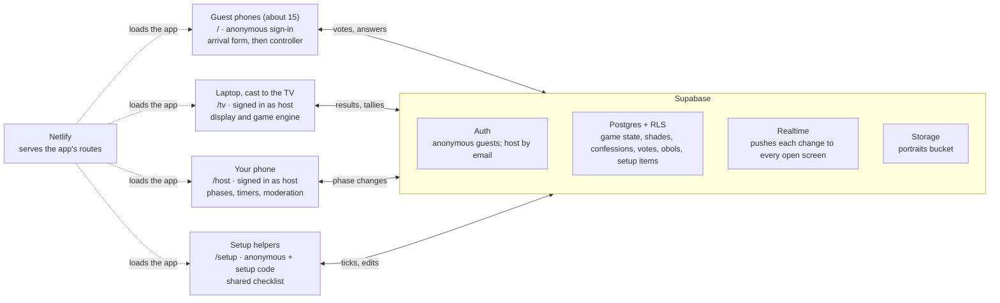

# Trial of the Shades: technical spec

A static React app on Netlify, with Supabase for auth, data, realtime and photo storage, runs the setup checklist, the arrival form, the Hall of Shades and the three-round Trial for about 15 guests on Saturday 31 October. Game content and copy come from the [game plan](game-plan.md); the setup checklist content comes from the [setup plan](setup-plan.md).

**Stack**

- Vite + React + TypeScript, no router library (route by `location.pathname`).
- Supabase: anonymous sign-in for guests, email sign-in for the host, Postgres with row-level security (RLS), Realtime `postgres_changes`, Storage for portraits.
- Netlify: static hosting from this GitHub repo, SPA fallback, two environment variables.

**In scope:** the setup checklist page, arrival form, Hall of Shades gallery, Rounds 1–3, obol scoring, host remote with moderation, portrait export.

**Out of scope:** Persephone's Seeds (paper only), the photo booth and Google album, accounts beyond the host, any reuse after the party.

## Architecture



Netlify only hosts files. Sign-in, game state, live updates and photos all go through Supabase, guarded by row-level security.

## Routes and screens

The display and the controls are separate routes, because casting a Chrome tab mirrors everything in it. A Next button on the TV page would show on the TV.

| Route | Runs on | Signed in as | Job |
| --- | --- | --- | --- |
| `/` | Guest phones | Anonymous | Arrival form, then a controller during the Trial |
| `/tv` | Laptop, cast to the Chromecast | Host | Full-screen display. Also the game engine: builds rounds, tallies votes, writes results |
| `/host` | Your phone, or a second laptop tab | Host | Remote: phase controls, timers, moderation, tie-breaks, export |
| `/setup` | Any phone | Anonymous + setup code | Shared setup checklist (see [Setup page](#setup-page-setup)) |

**Guest screens by phase**

| Phase | Phone shows |
| --- | --- |
| `lobby` | Form (name, guise, portrait, three confessions), then "Your shade is recorded" |
| `intro` to `r3_reveal`, no shade yet | Quick form for late arrivals (name and portrait only), then the current phase |
| `intro`, any `*_reveal` | "Look to the Court" (the TV) |
| `r1_vote` | Grid of players, minus yourself. The author sees the same grid titled "Frame a shade" |
| `r2_write` | Your two prompts, one text box each, 80 characters max |
| `r2_vote` | Answers A and B as two large buttons. The two authors see the same buttons, labelled as a bet |
| `r3_vote` | Elysium, Asphodel, Tartarus, each with its one-line description |
| `finale`, `after` | Your realm and your obol total. No score is shown on any phone before this |

**TV screens:** Hall of Shades gallery (8-second crossfade, name and guise, small QR in a corner, realm labels once judged), opening lines, each round's prompt with a timer and a "9 of 15 have judged" counter, reveals, and the final realm-by-realm reveal and leaderboard.

**Host remote:** current phase and step, Next, +10 seconds, hide an item, pick a tie-break realm, close the arrival form, download all portraits, and Reset game (confirmation required).

## Game phases

One row, `game`, holds `phase`, `step` and `deadline_at`. Only the host remote changes it, through the `set_phase` function. Every screen renders from it, and `/tv` reacts to each change by doing the work in the last column. Each entry step is idempotent, so a double-processed change is harmless.

| Phase | `step` means | Timer | What `/tv` does on entry |
| --- | --- | --- | --- |
| `lobby` | — | — | Shows the Hall of Shades; shades can be created |
| `intro` | — | — | Switches arrivals to the quick form; builds `r1_items`, `r2_matchups`, `r3_items` (see Game logic) |
| `r1_vote` | Item 0–7 | 20 s | Shows the confession |
| `r1_reveal` | Same item | — | Tallies votes, sets the author, writes obols |
| `r2_write` | — | 90 s | Shows "The petitions are being written" with a submitted count |
| `r2_vote` | Matchup 0–n | 20 s | Copies both answers into the public matchup row in random order |
| `r2_reveal` | Same matchup | — | Tallies, reveals the writers, writes obols |
| `r3_vote` | Shade 0–n | 12 s | Shows the portrait, guise and bargain |
| `r3_reveal` | 0, 1, 2 = Tartarus, Asphodel, Elysium | — | Works out the majority realm per shade (ties go to the host remote), but writes `shades.realm` only for the realm being revealed at each step, so phones can't see results early |
| `finale` | — | — | Favored of Hades, closing lines |
| `after` | — | — | Hall of Shades with realm labels |

Next advances `step` within a round and moves to the next phase after the last item. A vote phase never auto-advances; when the timer ends, the TV shows "The Court has heard enough" until the host presses Next.

## Data model and security

The anon key ships in the bundle, so RLS is the security boundary. Input that must stay anonymous (confessions, answers, votes) goes into private tables only the writer and the host can read. The host engine copies what the room should see into public tables at the right moment.

| Table | Holds | Read | Write |
| --- | --- | --- | --- |
| `hosts` | Host user ids | Host | SQL editor only |
| `game` | One row: `phase`, `step`, `deadline_at` | Everyone | Host, via `set_phase()` |
| `shades` | Name, guise, portrait path, `hidden`, `realm`, `late` | Everyone | Own row during `lobby`, or a late shade until `finale`; host for `hidden`, `realm` |
| `confessions` | Sin, talent, bargain | Own + host | Own row during `lobby` |
| `hidden_items` | Moderated confessions and answers | Host | Host |
| `r1_items` | Confession text; author once revealed | Everyone | Host |
| `r2_assignments` | Which two shades write each matchup | Own + host | Host |
| `r2_answers` | Answer text | Own + host | Own, during `r2_write`, if assigned |
| `r2_matchups` | Prompt; answers once voting opens; writers and counts once revealed | Everyone | Host |
| `r3_items` | Judgment order | Everyone | Host |
| `votes` | One choice per voter per item | Own + host | Own, only while that item's vote is open |
| `obols` | Points ledger | Everyone | Host |

**`supabase/schema.sql`** (run once in the SQL editor)

```sql
-- Host role
create table hosts (user_id uuid primary key references auth.users on delete cascade);
create function is_host() returns boolean language sql stable security definer set search_path = public as $$
  select exists (select 1 from hosts where user_id = auth.uid()) $$;

-- Game state
create table game (
  id int primary key default 1 check (id = 1),
  phase text not null default 'lobby',
  step int not null default 0,
  deadline_at timestamptz,
  updated_at timestamptz not null default now());
insert into game default values;

create function set_phase(p text, s int, seconds int default 0) returns void
language plpgsql security definer set search_path = public as $$
begin
  if not is_host() then raise exception 'not host'; end if;
  update game set phase = p, step = s, updated_at = now(),
    deadline_at = case when seconds > 0 then now() + make_interval(secs => seconds) end
  where id = 1;
end $$;

create function server_now() returns timestamptz language sql stable as $$ select now() $$;

create function in_phase(p text) returns boolean language sql stable as $$
  select exists (select 1 from game where phase = p) $$;

create function vote_open(r smallint, i int) returns boolean language sql stable as $$
  select exists (select 1 from game where phase = 'r' || r || '_vote' and step = i
    and now() < deadline_at + interval '3 seconds') $$;

-- Shades and private confessions
create table shades (
  id uuid primary key default auth.uid() references auth.users on delete cascade,
  name text not null check (char_length(name) between 1 and 40),
  guise text check (char_length(guise) <= 60),
  portrait_path text,
  hidden boolean not null default false,
  realm text check (realm in ('elysium', 'asphodel', 'tartarus')),
  late boolean not null default false,
  created_at timestamptz not null default now());

-- Guests cannot change host-owned columns; a shade created after the lobby is marked late
create function guard_shade() returns trigger language plpgsql as $$
begin
  if not is_host() then
    new.hidden := coalesce(old.hidden, false); new.realm := old.realm;
    new.late := coalesce(old.late, not in_phase('lobby'));
  end if;
  return new;
end $$;
create trigger guard_shade before insert or update on shades for each row execute function guard_shade();

create table confessions (
  shade_id uuid primary key default auth.uid() references shades on delete cascade,
  sin text check (char_length(sin) <= 140),
  talent text check (char_length(talent) <= 140),
  bargain text check (char_length(bargain) <= 140));

-- Moderation: the engine skips anything listed here
create table hidden_items (kind text not null check (kind in ('confession', 'answer')), ref text not null,
  primary key (kind, ref));

-- Rounds
create table r1_items (idx int primary key, text text not null, author_id uuid references shades, correct int);
create table r2_assignments (matchup int, slot char(1) check (slot in ('a', 'b')), writer_id uuid not null references shades,
  primary key (matchup, slot));
create table r2_answers (matchup int, writer_id uuid default auth.uid() references shades,
  text text not null check (char_length(text) <= 80), primary key (matchup, writer_id));
create table r2_matchups (idx int primary key, prompt text not null, subject_id uuid references shades,
  answer_a text, answer_b text, writer_a uuid, writer_b uuid, votes_a int, votes_b int);
create table r3_items (idx int primary key, shade_id uuid not null references shades);
create table votes (voter_id uuid default auth.uid() references auth.users, round smallint, item int,
  choice text not null, created_at timestamptz not null default now(), primary key (voter_id, round, item));
create table obols (id bigserial primary key, shade_id uuid not null references shades, amount int not null,
  round smallint not null, item int not null, reason text not null, unique (shade_id, round, item, reason));

-- RLS
alter table hosts enable row level security;
alter table game enable row level security;
alter table shades enable row level security;
alter table confessions enable row level security;
alter table hidden_items enable row level security;
alter table r1_items enable row level security;
alter table r2_assignments enable row level security;
alter table r2_answers enable row level security;
alter table r2_matchups enable row level security;
alter table r3_items enable row level security;
alter table votes enable row level security;
alter table obols enable row level security;

create policy host_read on hosts for select using (user_id = auth.uid());
create policy read_all on game for select to authenticated using (true);

create policy read_all on shades for select to authenticated using (true);
create policy own_insert on shades for insert to authenticated with check (
  id = auth.uid() and not in_phase('finale') and not in_phase('after'));
create policy own_update on shades for update to authenticated using (
  id = auth.uid() and (in_phase('lobby') or (late and not in_phase('finale') and not in_phase('after'))));
create policy host_all on shades for all to authenticated using (is_host()) with check (is_host());

create policy own_or_host_read on confessions for select to authenticated using (shade_id = auth.uid() or is_host());
create policy own_insert on confessions for insert to authenticated with check (shade_id = auth.uid() and in_phase('lobby'));
create policy own_update on confessions for update to authenticated using (shade_id = auth.uid() and in_phase('lobby'));

create policy host_all on hidden_items for all to authenticated using (is_host()) with check (is_host());

create policy read_all on r1_items for select to authenticated using (true);
create policy read_all on r2_matchups for select to authenticated using (true);
create policy read_all on r3_items for select to authenticated using (true);
create policy read_all on obols for select to authenticated using (true);
create policy host_all on r1_items for all to authenticated using (is_host()) with check (is_host());
create policy host_all on r2_matchups for all to authenticated using (is_host()) with check (is_host());
create policy host_all on r3_items for all to authenticated using (is_host()) with check (is_host());
create policy host_all on obols for all to authenticated using (is_host()) with check (is_host());
create policy host_all on r2_assignments for all to authenticated using (is_host()) with check (is_host());
create policy own_read on r2_assignments for select to authenticated using (writer_id = auth.uid());

create policy own_or_host_read on r2_answers for select to authenticated using (writer_id = auth.uid() or is_host());
create policy own_write on r2_answers for insert to authenticated with check (
  writer_id = auth.uid() and in_phase('r2_write')
  and exists (select 1 from r2_assignments a where a.matchup = r2_answers.matchup and a.writer_id = auth.uid()));
create policy own_update on r2_answers for update to authenticated using (writer_id = auth.uid() and in_phase('r2_write'));

create policy own_or_host_read on votes for select to authenticated using (voter_id = auth.uid() or is_host());
create policy own_write on votes for insert to authenticated with check (voter_id = auth.uid() and vote_open(round, item));
create policy own_update on votes for update to authenticated using (voter_id = auth.uid() and vote_open(round, item));
create policy host_delete on votes for delete to authenticated using (is_host());

-- Realtime (postgres_changes respects RLS)
alter publication supabase_realtime add table game, shades, r1_items, r2_matchups, r3_items, obols, votes, r2_answers;
```

Portrait storage policies are under [Portraits](#portraits). Reset game is a host-only `reset_game()` function in `supabase/reset.sql` that truncates every game table (not `hosts` or the setup tables) and sets `game` back to `lobby`.

## Realtime, timing and sync

Every client keeps one Supabase channel open and renders from a local store, refetching in full whenever it might have missed something. Phones lock their screens constantly at a party, so recovery is the normal path, not an edge case.

- **Subscriptions.** Guests: `game`, `shades`, `r1_items`, `r2_matchups`, `obols`. `/tv` adds `votes` and `r2_answers` for its live counters. RLS filters what each client receives.
- **Recovery.** On `visibilitychange` to visible, on channel `SUBSCRIBED` after a reconnect, and every 30 s as a safety net, refetch `game` plus the tables the current phase needs.
- **Timers.** Deadlines are set by the database (`set_phase` uses `now()`), never by a device clock. Each client calls `server_now()` once on load to get its clock offset and counts down against `deadline_at`. Vote writes get a 3-second grace window in `vote_open()` for slow phones.
- **Votes.** One `upsert` per tap, so changing your mind before the timer ends is allowed. The phone shows its own vote back from the database, so a failed write is visible.
- **Live counters.** `/tv` counts distinct `voter_id`s for the current item from its `votes` subscription.
- **Expected load.** About 17 open connections (15 phones, `/tv`, `/host`) and a few hundred writes over the night, far inside Supabase's free tier.

## Portraits

Portraits are resized on the phone before upload, so 15 photos stay small and the gallery loads instantly on the TV.

- **Capture.** `<input type="file" accept="image/*" capture="user">`. iOS and Android hand back a JPEG, and guests can retake before submitting.
- **Resize.** `createImageBitmap` (applies EXIF rotation), drawn to a canvas at 1080 px on the long edge, exported as JPEG at quality 0.8, roughly 150–250 KB.
- **Storage.** A public bucket, `portraits`, with one object per shade at `<user id>.jpg`. Paths are random UUIDs and the photos appear on a shared TV anyway, so public read is acceptable. Writes are limited to your own file:

Overwriting a file (`upsert`) also needs a select policy, so retakes need all three:

```sql
create policy own_portrait_select on storage.objects for select to authenticated
  using (bucket_id = 'portraits' and name = auth.uid()::text || '.jpg');
create policy own_portrait_insert on storage.objects for insert to authenticated
  with check (bucket_id = 'portraits' and name = auth.uid()::text || '.jpg');
create policy own_portrait_update on storage.objects for update to authenticated
  using (bucket_id = 'portraits' and name = auth.uid()::text || '.jpg');
create policy host_portrait_delete on storage.objects for delete to authenticated
  using (bucket_id = 'portraits' and is_host());
```

- **Cache busting.** Retakes overwrite the same path, so `shades.portrait_path` stores `<user id>.jpg?v=<timestamp>`.
- **Export for the album.** The host remote's "Download all portraits" builds a zip in the browser (JSZip) with files named `<name> - <guise>.jpg`, ready to drop into the Google Photos album.

## Game logic

All round building and scoring lives in pure functions in `src/lib/`, unit-tested, and called by `/tv` on entering `intro` and each reveal. "Players" below means shades that are neither hidden nor late. Late shades can vote from the round after they join, and only Round 1 guesses earn them obols.

**Round setup (on `intro`)**

- **Round 1.** Pick 8 confessions, at most one per shade, from sins and talents (skip empty ones and anything hidden). Prefer shades with portraits, shuffle, write to `r1_items` with `author_id` null.
- **Round 2.** With n players (n ≥ 3), shuffle them and take n prompts from the pool. Matchup i goes to players i and (i + 1) mod n, so everyone writes exactly two. For a `[Name]` prompt, pick a subject who isn't one of its two writers. Write `r2_assignments` (private) and `r2_matchups` (prompt only).
- **Round 3.** Every player in shuffled order, written to `r3_items`.
- **Prompt pool.** The 15 prompts from the game plan plus 5 spares, so up to 20 players work. The content lives in `src/content/`, with all on-screen copy from the game plan.

**Scoring** (written to `obols` on each reveal; the unique key makes rewrites safe)

| Round | Who | Obols |
| --- | --- | --- |
| 1 | Each guesser who names the author | +1 |
| 1 | Author, per guesser who did not name them | +1 |
| 1 | Author, per guesser who picked the shade they framed | +1 |
| 2 | Each writer, per vote received | +1 |
| 2 | A writer who got every vote (at least 3 votes cast) | +2 bonus |
| 2 | Each writer who bet on the winning answer | +1 |
| 3 | — | No obols |

- **Round 1 voting.** The author's vote is stored like any other but read as their frame pick.
- **Invalid votes.** `votes.choice` isn't checked by the database, so tallies ignore any choice that isn't a player id (Round 1), `a`/`b` (Round 2) or a realm (Round 3).
- **Round 2 edge cases.** A missing answer shows as "The Court received no petition", and the other writer wins by default without the bonus. A tied vote gives no bet points.
- **Round 3.** Majority realm wins. A tie (or no votes) pauses on the host remote for a pick before the reveal can start.
- **Favored of Hades.** Highest obol total. A tie is announced as joint favorites.
- **Hidden scores.** `obols` is readable for simplicity, but no phone or TV screen shows totals before `finale`.

## Setup page (`/setup`)

A fourth route turns the [setup plan](setup-plan.md) into a live checklist. Sarah, Mark and the helpers open it on any phone from one link, then edit and tick items, with no accounts. It shares the Supabase project with the game but nothing else.

- **Access.** The first visit asks for a name and a setup code. `join_setup()` checks the code and adds that anonymous user to `setup_editors`. Without the code, the page shows nothing. The host joins with the code too, because `done_by` must point at a row in `setup_editors`.
- **Code strength.** `join_setup()` can be called repeatedly, so use a code of three or more words (for example `pomegranate-six-seeds`), not a short PIN.
- **Content.** Sections (rooms, shopping by store, Saturday), each holding items with text, an optional owner (free text, such as "Mark") and an optional note. The layout sketches show as read-only images at the bottom.
- **Editing.** Tick and untick, edit text inline, add items and sections, move items up or down, and delete with a 5-second undo.
- **Live.** Ticks appear on everyone's phone straight away. A ticked item shows who did it, for example "done by Mark".
- **Filters.** All, Not done, and Mine (matched on owner), which makes the shopping list usable in a shop.
- **Seed.** `supabase/seed_setup.sql` is generated from the setup plan once it's final, so the page starts from that version.

```sql
-- Setup checklist
create table setup_secret (id int primary key default 1 check (id = 1), code text not null);  -- RLS on, no policies: unreadable from the app
create table setup_editors (user_id uuid primary key default auth.uid() references auth.users on delete cascade,
  name text not null check (char_length(name) between 1 and 30));
create table setup_sections (id uuid primary key default gen_random_uuid(), title text not null,
  kind text not null check (kind in ('room', 'shopping', 'day')), position int not null);
create table setup_items (id uuid primary key default gen_random_uuid(),
  section_id uuid not null references setup_sections on delete cascade,
  text text not null check (char_length(text) <= 200), owner text, note text, position int not null,
  done_by uuid references setup_editors (user_id), done_at timestamptz,
  updated_at timestamptz not null default now());

create function is_setup_editor() returns boolean language sql stable security definer set search_path = public as $$
  select exists (select 1 from setup_editors where user_id = auth.uid()) or is_host() $$;

create function join_setup(p_code text, p_name text) returns boolean
language plpgsql security definer set search_path = public as $$
begin
  if not exists (select 1 from setup_secret where code = p_code) then return false; end if;
  insert into setup_editors (user_id, name) values (auth.uid(), p_name)
    on conflict (user_id) do update set name = excluded.name;
  return true;
end $$;

alter table setup_secret enable row level security;
alter table setup_editors enable row level security;
alter table setup_sections enable row level security;
alter table setup_items enable row level security;
create policy editors_read on setup_editors for select to authenticated using (is_setup_editor());
create policy editors_all on setup_sections for all to authenticated using (is_setup_editor()) with check (is_setup_editor());
create policy editors_all on setup_items for all to authenticated using (is_setup_editor()) with check (is_setup_editor());
alter publication supabase_realtime add table setup_sections, setup_items;

insert into setup_secret (code) values ('<choose a code>');
```

The setup page ships first, ahead of the game, so Friday's setup can run from it.

## Repo layout (planned)

```text
the-court-below/
  README.md
  docs/                     game plan, tech spec, setup plan, sketches
  netlify.toml              build: npm run build, publish: dist, /* -> /index.html 200
  .env.example              VITE_SUPABASE_URL, VITE_SUPABASE_ANON_KEY
  supabase/
    schema.sql              tables, RLS, functions, realtime, storage policies
    reset.sql               reset_game()
    seed_setup.sql          setup checklist content
  src/
    main.tsx                route by pathname: /, /tv, /host, /setup
    lib/
      supabase.ts           client, anonymous sign-in, clock offset
      store.ts              subscriptions, refetch on resume
      rounds.ts             round builders (pure)
      scoring.ts            tallies and obols (pure)
      image.ts              resize and upload
    content/
      prompts.ts            Round 2 prompt pool
      copy.ts               every on-screen line from the game plan
    guest/                  form and controller screens
    tv/                     gallery, round displays, engine.ts
    host/                   sign-in, remote, moderation, export
    setup/                  checklist page
    styles/                 dark theme tokens, display serif + clean sans
  tests/                    rounds and scoring unit tests (Vitest)
```

## Setup and deploy

About 15 minutes in two dashboards, then every push to `main` redeploys.

**Supabase**

1. Create a free project in an EU region (Frankfurt is closest).
2. In Authentication settings, turn on anonymous sign-ins.
3. In Authentication → Users, add the host user with your email and a password.
4. In the SQL editor, run `supabase/schema.sql`, then add yourself as host: `insert into hosts select id from auth.users where email = '<your email>';`
5. Create a public Storage bucket named `portraits` (or `insert into storage.buckets (id, name, public) values ('portraits', 'portraits', true);`), then run the storage policies.
6. Copy the project URL and the anon (publishable) key from the API settings.

**Netlify**

1. Add a new site from this GitHub repo. Build settings come from `netlify.toml`.
2. Set `VITE_SUPABASE_URL` and `VITE_SUPABASE_ANON_KEY` as environment variables, then deploy.
3. Rename the site to something short, such as `court-below.netlify.app`, since it goes in the QR code.

**Party materials**

- The host remote has a "Print QR card" view that renders the guest URL as a QR code with the Wi-Fi details, in the party's style.
- The TV gallery renders the same QR code itself, so nothing needs regenerating if the URL changes.
- Free Supabase projects pause after about a week without activity. Open the dashboard on Saturday afternoon to be sure it's awake.

## Testing and failure modes

A rehearsal mode on the host remote makes a full run possible with only two or three real phones: "Seed 12 test shades" adds fake shades with confessions and placeholder portraits, and "Auto-vote" casts random votes for them each round. Reset game clears everything before guests arrive.

**Before Saturday**

- [ ] Vitest: round builders for 3, 8, 15 and 20 players; every scoring rule and tie case.
- [ ] RLS check: as a guest, try to read `confessions`, `r2_answers` and others' `votes`, write to `game`, vote outside the window, overwrite another shade, set your own `hidden`, `realm` or `late`, and write confessions after the lobby. All must fail.
- [ ] Retake a portrait and confirm the overwrite succeeds.
- [ ] RLS check for `/setup`: without the code, every setup table read and write must fail.
- [ ] Friday rehearsal: laptop casting `/tv`, your phone on `/host`, two or three phones plus seeded shades, all three rounds end to end.
- [ ] Lock a phone mid-round, unlock it and confirm it catches up.
- [ ] Upload a portrait from an iPhone and an Android phone.

**What can go wrong at the party**

| Failure | Effect | Handling |
| --- | --- | --- |
| Phone locks or drops Wi-Fi | Misses updates | Refetch on resume; mobile data works too |
| Guest opens the QR in another browser | New anonymous user, duplicate shade | Host hides the duplicate |
| Guest misses a vote | No vote | Counters and scoring only count votes cast |
| Cast tab freezes | TV stalls | Recast; `/tv` reloads from `game` and carries on |
| Laptop dies | No TV and no engine | Open `/tv` on any device signed in as host; state lives in Supabase |
| Host phone dies | No remote | Open `/host` in a second laptop tab |
| Offensive answer | Shows on TV | The remote lists confessions and answers as they arrive; hide one there and the engine skips it |
| Fewer than 3 players | Round 2 can't run | Remote skips Round 2 |

## Decisions

- **Late guests after 23:00:** quick join with name and portrait only; they vote from the next round (see Game logic).
- **Obol totals:** hidden until the finale.

## Open questions

- [ ] Which email should be the host account? It's the Supabase login that `/tv` and `/host` sign in with; any address Sarah can receive mail at works.
- [ ] Setup code to share with Mark and the helpers.

The Netlify site name gets picked at first deploy, before the QR cards are printed. The Friday rehearsal has no fixed time: it happens in the evening while friends help decorate.
