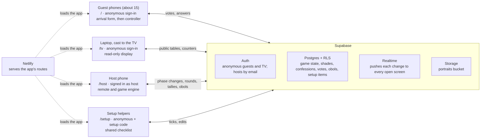

# Trial of the Shades: technical spec

A static React app on Netlify, with Supabase for auth, data, realtime and photo storage, runs the setup checklist, the arrival form, the Hall of Shades and the three-round Trial for about 15 guests on Saturday 31 October. Game content and copy come from the [game plan](game-plan.md); the setup checklist content comes from the [setup plan](setup-plan.md).
The build followed [the implementation plan](superpowers/plans/2026-10-30-trial-of-the-shades.md), whose "Changes from the spec" section lists where it departed from the first version of this spec.

**Stack**

- Vite + React + TypeScript, no router library (route by `location.pathname`).
- Supabase: anonymous sign-in for guests and the TV, email sign-in for the hosts, Postgres with row-level security (RLS), Realtime `postgres_changes`, Storage for portraits.
- Netlify: static hosting from this GitHub repo, SPA fallback, two environment variables.

**In scope:** the setup checklist page, arrival form, Hall of Shades gallery, Rounds 1–3, obol scoring, host remote with moderation and rehearsal tools.

**Out of scope:** Persephone's Seeds (paper only), the photo booth and Google album, a portrait export, a printable QR card, accounts beyond the hosts, any reuse after the party.

## Architecture



Netlify only hosts files. Sign-in, game state, live updates and photos all go through Supabase, guarded by row-level security.

## Routes and screens

The display and the controls are separate routes, because casting a Chrome tab mirrors everything in it. A Next button on the TV page would show on the TV.

| Route | Runs on | Signed in as | Job |
| --- | --- | --- | --- |
| `/` | Guest phones | Anonymous | Arrival form, then a controller during the Trial |
| `/tv` | Laptop, cast to the Chromecast | Anonymous | Full-screen, read-only display of the game |
| `/host` | A host's phone, or a second laptop tab | Host | Remote and game engine: phases, timers, moderation, rehearsal tools |
| `/setup` | Any phone | Anonymous + setup code | Shared setup checklist (see [Setup page](#setup-page-setup)) |

**Guest screens by phase**

| Phase | Phone shows |
| --- | --- |
| `lobby` | Form (name, guise, portrait, three confessions), then "Your shade is recorded", a countdown to 23:00 and "Edit my shade". An edit still open when the Court opens is dropped |
| Any phase before `finale`, no shade yet | The same form with only name and portrait, under the late welcome line |
| `r1_vote` | Grid of players, minus yourself, under the confession. The author sees the same grid titled "Frame a shade" |
| `r2_write` | Your two prompts, one text box each, 80 characters max, saved on blur or Save, and once more at time-up. If that last save fails, the boxes stay so the guest can retry until Next |
| `r2_vote` | Answers A and B as two large buttons. The two authors see the same buttons with a line saying their tap is a bet |
| `r3_vote` | The shade's name, then Elysium, Asphodel, Tartarus, each with its description |
| `finale`, `after` | Your portrait, realm and obol total. No score is shown on any phone before this |
| Anything else | "Look to the Court" (the TV). A vote screen whose time is up shows "The Court has heard enough" |

**TV screens:** Hall of Shades in `lobby` and `after` (one portrait at a time, 8-second crossfade, name and guise, a QR code of the site in a corner, realm labels in `after`), the opening (lines, the obol line, the Seeds toast), each round's intro, each item with a countdown and a "9 of 15 have judged" counter, reveals, the realm-by-realm reveal, the obol leaderboard and the Favored of Hades.

**Host remote:** the phase in words, the countdown and the live counter, Next (labelled with where it goes, and during Round 2 writing with how many petitions are still missing), Back (see below), +10 seconds, the shade list with Hide (for duplicates; shades already in the Trial can't be hidden), moderation lists (confessions in the lobby, petitions in Round 2), and a Rehearsal section: Seed 12 test shades, Auto-vote for test shades ("Write test petitions" during Round 2 writing), and Reset game (with a confirmation).

## Game phases

One row, `game`, holds `phase`, `step` and `deadline_at`. Only the host remote changes it, through `set_phase()`. Every screen renders from it.
The remote is the engine: Next calls `set_phase()` first, which closes any open vote, then does the new phase's entry work from fresh data. Entry work is idempotent, and the remote reruns it whenever it loads, so a reload or a dead phone mid-reveal is harmless.
Back (`prevStep()`, the exact inverse of Next) undoes what the screen it leaves had written: leaving a reveal for its vote deletes that item's obols and hides the result, so the vote reopens with a fresh clock and Next tallies again; leaving the first Round 2 vote takes those answers off the TV; leaving a Judgment reveal clears the realms it showed. Back is disabled on the first opening screen, because the rounds are already built from the shades in the lobby.
Two remotes are safe too. Next passes `set_phase()` the phase and step it saw, and the database refuses the move if the game has already left them, so two presses at once move one step. The rounds are written by `build_rounds()` in one transaction, which does nothing if they already exist.

| Phase | `step` means | Timer | Entry work on the remote |
| --- | --- | --- | --- |
| `lobby` | — | — | — (shades can be created) |
| `intro` | 0 opening lines, 1 obols, 2 the Seeds toast | — | Builds `r1_items` with `r1_authors`, `r2_matchups` with `r2_assignments`, and `r3_items` (see Game logic), if not built yet. Shades created from now on are late |
| `r1_intro` | — | — | — |
| `r1_vote` | Item 0–7 | 20 s | — |
| `r1_reveal` | Same item | — | Tallies, writes obols, then publishes the author, `correct` and `guessers` |
| `r2_intro` | — | — | — |
| `r2_write` | — | 90 s | — |
| `r2_vote` | Matchup 0–n | 20 s | Copies both answers (null if missing or hidden) into that matchup's public row |
| `r2_reveal` | Same matchup | — | Tallies, writes obols, then publishes the writers and the vote split |
| `r3_intro` | 0 intro line, 1 the three realms | — | — |
| `r3_vote` | Shade 0–n | 12 s | Copies that shade's bargain (unless hidden) into its public `r3_items` row |
| `r3_reveal` | 0, 1, 2 = Tartarus, Asphodel, Elysium | — | Works out every shade's realm, but writes `shades.realm` only for the realms revealed so far, so phones can't see results early |
| `finale` | 0 leaderboard, 1 closing lines and Favored of Hades | — | — |
| `after` | — | — | — (Hall of Shades with realm labels) |

`src/lib/phases.ts` holds this order. A round with nothing in it is skipped with its intro (Round 2 needs 3 players). A vote phase never auto-advances; when the timer ends, screens show "The Court has heard enough" until the host presses Next.

## Data model and security

The anon key ships in the bundle, so RLS is the security boundary. Input that must stay anonymous (confessions, answers, votes, Round 1 authors) goes into private tables only the writer and the hosts can read. The remote copies what the room should see into public tables at the right moment.

| Table | Holds | Read | Write |
| --- | --- | --- | --- |
| `hosts` | Host user ids | Host | SQL editor only |
| `game` | One row: `phase`, `step`, `deadline_at` | Everyone | Host, via `set_phase()` and `add_time()` |
| `shades` | Name, guise, portrait path, `hidden`, `realm`, `late`, `test` | Everyone | Own row during `lobby`, or a late shade until `finale`; host for everything |
| `confessions` | Sin, talent, bargain | Own + host | Own row during `lobby`; host |
| `hidden_items` | Moderated confessions and answers | Host | Host |
| `r1_items` | Confession text; author, `correct`, `guessers` once revealed | Everyone | Host |
| `r1_authors` | Each Round 1 item's author, until the reveal | Host | Host |
| `r2_assignments` | Which two shades write each matchup | Own + host | Host |
| `r2_answers` | Answer text | Own + host | Own, during `r2_write`, if assigned; host |
| `r2_matchups` | Prompt and note; answers once opened; writers and counts once revealed | Everyone | Host |
| `r3_items` | Judgment order; the bargain once opened | Everyone | Host |
| `votes` | One choice per voter per item | Own + host | Own, only while that item's vote is open; host |
| `obols` | Points ledger | Everyone | Host |

- **The SQL** is `supabase/schema.sql`, pasted once into the SQL editor after `hosts.sql`. It holds the tables, RLS policies, functions, the Realtime publication, the `portraits` bucket and its storage policies, and `reset_game()`. Read it there rather than here, so the two never drift.
- **Functions:** `set_phase(p, s, seconds, from_phase, from_step)`, `build_rounds(r1, r2, r2_writers, r3)`, `add_time(seconds)` and `reset_game()` (host only); `server_now()`; `vote_count(round, item)` and `answer_count()`, which tell anyone how many, never who.
- **Guards:** a trigger stops guests setting `hidden`, `realm`, `test` or `late`, and marks a shade created after the lobby as late. `vote_open()` allows a vote while its item is up plus 3 seconds of grace.
- **Test shades:** `shades.id` and `votes.voter_id` have no foreign key to `auth.users`, so the remote can create test shades and vote for them.
- **Checks:** `tests/db/rls.test.ts` runs every rule against a local Postgres (PGlite) on each `npm test`; `supabase/game_rls_checks.md` repeats them by hand against the live project.

## Realtime, timing and sync

Every client keeps one Supabase channel open and renders from one load of the game, refetched in full whenever it might have missed something. Phones lock their screens constantly at a party, so recovery is the normal path, not an edge case.

- **Subscriptions.** Everyone subscribes to `game`, `shades`, `r1_items`, `r2_matchups`, `r3_items` and `obols`. Any change triggers a debounced full refetch (`src/lib/useGame.ts`). Only the newest refetch may update the screen, so a slow older one can't roll it back. RLS filters what each client receives.
- **Recovery.** Refetch on `visibilitychange` to visible, on `SUBSCRIBED`, when Realtime reports database changes flowing (a moment after `SUBSCRIBED`; see `agent_docs/local-supabase.md`), and every 30 s (every 5 s on the remote, which also lists confessions and answers that aren't in the publication).
- **Stale screens.** When a load fails, the screen keeps what it has and shows "Reconnecting…" in a corner until a load succeeds, so a frozen screen never looks live. The TV also signs itself in again if its session is lost (it has no identity to lose); guests can't, since a new sign-in is a new user.
- **Timers.** Deadlines are set by the database (`set_phase` uses `now()`), never by a device clock. Each client calls `server_now()` once to get its clock offset and counts down against `deadline_at`.
- **Votes.** One `upsert` per tap, so changing your mind before the timer ends is allowed. The phone shows its own vote read back from the database.
- **Counters.** The TV and the remote poll `vote_count()` or `answer_count()` every 2 seconds during timed phases.
- **Expected load.** About 17 open connections (15 phones, `/tv`, `/host`) and a few hundred writes over the night, far inside Supabase's free tier.
- **Sign-in limit.** Supabase allows 30 anonymous sign-ins per IP address per hour by default, and the whole party shares one Wi-Fi address. Raise it (Authentication → Rate Limits) before the party. If it's hit anyway, phones say so and suggest mobile data.

## Portraits

Portraits are resized on the phone before upload, so 15 photos stay small and the gallery loads instantly on the TV.

- **Capture.** `<input type="file" accept="image/*" capture="user">`, with a preview and Retake. The portrait is optional; screens show the name's initial without one.
- **Resize.** `createImageBitmap` (applies EXIF rotation), drawn to a canvas at 1080 px on the long edge, exported as JPEG at quality 0.8 (`src/lib/image.ts`).
- **Storage.** A public bucket, `portraits`, with one object per shade at `<user id>.jpg`. Paths are random UUIDs and the photos appear on a shared TV anyway, so public read is acceptable. Writes are limited to your own file; retakes overwrite it, and `shades.portrait_path` stores `<user id>.jpg?v=<timestamp>` to bust caches.

## Game logic

All round building and scoring lives in pure functions in `src/lib/` (`rounds.ts`, `scoring.ts`, `phases.ts`), unit-tested in `tests/game/`. "Players" below means shades that are neither hidden nor late. "Voters" means every shade that isn't hidden: late shades vote as soon as they join.

**Round setup (on `intro`)**

- **Round 1.** Up to 8 confessions, at most one per shade, each a sin or a talent at random (skipping empty and hidden ones). Shades with portraits first, shuffled. The text goes to `r1_items`, the author to the private `r1_authors`.
- **Round 2.** With n players (n ≥ 3), shuffle them and the prompts. Matchup i goes to players i and (i + 1) mod n, so everyone writes exactly two, against two different people. For a `[Name]` prompt, the subject is a shade who isn't one of its two writers, spreading names around. Writes `r2_assignments` (private) and `r2_matchups` (prompt and note only).
- **Round 3.** Every player, shuffled, written to `r3_items`.
- **Prompt pool.** The 15 prompts from the game plan plus 5 spares, so up to 20 players work. All copy lives in `src/content/`, verbatim from the game plan.

**Scoring** (written to `obols` on each reveal; the unique key makes rewrites safe)

| Round | Who | Obols |
| --- | --- | --- |
| 1 | Each guesser who names the author | +1 |
| 1 | Author, per guesser who did not name them | +1 |
| 1 | Author, per guesser who picked the shade they framed | +1 |
| 2 | Each writer, per vote received | +1 |
| 2 | A writer who got every vote (at least 3 votes cast, both answers present) | +2 bonus |
| 2 | Each writer who bet on the winning answer | +1 |
| 3 | — | No obols |

- **Round 1 voting.** The author's vote is stored like any other but read as their frame pick.
- **Invalid votes.** Tallies ignore votes from anyone who isn't a voter, and any choice that isn't another player's id (Round 1), `a`/`b` for an answer that exists (Round 2), or a realm (Round 3).
- **Round 2 edge cases.** A missing or hidden answer shows as "The Court received no petition", and the other writer wins by default without the bonus. The TV highlights the same winner (`petitionWinner()`). A tied vote gives no bet points.
- **Round 3.** Majority realm wins. A tie, or no votes, sends the shade to Asphodel. Persephone can overrule out loud.
- **Favored of Hades.** Highest obol total. A tie is announced as joint favorites.
- **Hidden scores.** `obols` is readable for simplicity, but no phone or TV screen shows totals before `finale`.

## Setup page (`/setup`)

A fourth route turns the [setup plan](setup-plan.md) into a live, shared task list for Friday and Saturday.
The full design, including the ranking rules and the reasons behind them, is in [the setup page design](superpowers/specs/2026-10-29-setup-page-design.md).
It shares the Supabase project with the game, and the `hosts` table, but nothing else.

- **Views.** Next (the default: only to-dos you can do right now, best first; nothing blocked, not yet due or on the shopping list), Rooms (every room and Saturday before doors, open and done), Priority (Must, Should, Nice to have, without shopping), and Shopping (the shopping sections, by shop).
  A shopping item can still block a to-do, so buying something can unlock work in Next.
- **Tasks.** Each has a room, an assignee (Sarah, Mark, "Sarah or Mark", or anyone), a priority, an optional rough time slot, and optional blockers. A task is doable when none of its blockers are open and its slot is now; a slot that has passed marks it late.
- **People.** Sarah and Mark sign in with their host email and password and can edit everything. Helpers ("Pain & Panic") enter their name and the setup code `pain-and-panic` and can only tick and untick; the database enforces this through `set_task_done()`.
- **Live.** Realtime pushes every change to every phone; phones also refetch on unlock, on reconnect and every 30 seconds.
- **SQL.** `supabase/hosts.sql`, then `supabase/setup.sql`, then `supabase/seed_setup.sql`, pasted into the SQL editor in that order. The seed refuses to run twice.
- **Editing the list later.** The Supabase MCP is read-only, so Claude reads the live list and writes small SQL scripts that target tasks by their fixed `key`. Sarah pastes them.
- **Checks.** `supabase/setup_rls_checks.md` lists the RLS checks to run against the live project.

The setup page ships first, ahead of the game, so Friday's setup can run from it.


## Repo layout

```text
the-court-below/
  README.md
  agent_docs/               gotchas and how-tos for whoever works on this next
  docs/                     game plan, tech spec, setup plan, plans and specs
  netlify.toml              build: npm run build, publish: dist, /* -> /index.html 200
  .env.example              VITE_SUPABASE_URL, VITE_SUPABASE_ANON_KEY
  supabase/
    hosts.sql               hosts table and is_host(), run first
    setup.sql               setup checklist tables, RLS, functions
    seed_setup.sql          setup checklist content (refuses to run twice)
    setup_rls_checks.md     setup RLS checks against the live project
    schema.sql              game tables, RLS, functions, realtime, portraits bucket, reset_game()
    game_rls_checks.md      game RLS checks against the live project
  src/
    main.tsx                route by pathname: /, /tv, /host, /setup
    lib/
      supabase.ts           client
      api.ts                every game read and write, rows mapped to types
      useGame.ts            subscriptions and refetch on resume
      game.ts               game types
      phases.ts             phase order and timers (pure)
      rounds.ts             round builders (pure)
      scoring.ts            tallies and obols (pure)
      clock.ts              server clock offset and countdowns
      image.ts              portrait resize
    content/
      copy.ts               every on-screen line from the game plan
      prompts.ts            Round 2 prompt pool
    guest/                  arrival form and controller screens
    tv/                     Hall of Shades and round displays
    host/                   remote, engine, moderation, rehearsal tools
    ui/                     shared portrait, speech and styles
    setup/                  checklist page: model, ranking, data hook, views
    styles/                 dark theme tokens
  tests/
    setup/, game/           unit tests (npm test)
    db/                     RLS tests against PGlite (npm test)
    local/                  end-to-end game against a local Supabase (npm run test:local)
```

## Setup and deploy

Every push to `main` redeploys on Netlify; pull requests get a deploy preview.

**Supabase**

1. In the SQL editor, run `supabase/hosts.sql` (it adds both hosts), `supabase/setup.sql` and `supabase/seed_setup.sql` for `/setup`, then `supabase/schema.sql` for the game. `schema.sql` also creates the `portraits` bucket and its policies.
2. In Authentication → Rate Limits, raise the anonymous sign-ins limit from 30 per hour to about 300.
3. Free Supabase projects pause after about a week without activity. Open the dashboard on Saturday afternoon to be sure it's awake.

Anonymous sign-ins, the host users and the Site URL are already set up (see CLAUDE.md).

**Netlify**

`VITE_SUPABASE_URL` and `VITE_SUPABASE_ANON_KEY` are set as environment variables; build settings come from `netlify.toml`.

**Party materials**

The TV's Hall of Shades shows a QR code of the site, so nothing needs regenerating if the URL changes. Print 2–3 cards with a QR code of `https://thecourtbelow.netlify.app` and the guest Wi-Fi details, from any QR generator.

## Testing and failure modes

**Automated**

- `npm test`: setup ranking, phases, round builders for 3, 8, 15 and 20 players, every scoring rule and tie case, and every RLS rule against PGlite.
- `npm run test:local`: a full game end to end against a local Supabase in Docker, through the app's own api and engine (see `agent_docs/local-supabase.md`).

**Rehearsal.** The remote's Rehearsal section makes a full run possible with two or three real phones: "Seed 12 test shades" adds shades with confessions, and "Auto-vote for test shades" writes their answers and casts their votes each round. Reset game clears everything before guests arrive.

**Before Saturday**

- [ ] Paste `schema.sql` into the live project and run `supabase/game_rls_checks.md`.
- [ ] Raise the anonymous sign-in rate limit.
- [ ] Rehearsal: laptop casting `/tv`, a phone on `/host`, two or three phones plus test shades, all three rounds end to end.
- [ ] Lock a phone mid-round, unlock it and confirm it catches up.
- [ ] Upload a portrait from an iPhone and an Android phone, and retake one.
- [ ] Reset game.

**What can go wrong at the party**

| Failure | Effect | Handling |
| --- | --- | --- |
| Phone locks or drops Wi-Fi | Misses updates | Refetch on resume; mobile data works too |
| Too many sign-ins from the Wi-Fi | New phones can't join | Raise the rate limit beforehand; phones suggest mobile data |
| Guest opens the QR in another browser | New anonymous user, duplicate shade | Host hides the duplicate on the remote, before Next in the lobby. After that a duplicate made in the lobby stays in the Trial: hiding it would break the rounds already built |
| Guest misses a vote | No vote | Counters and scoring only count votes cast |
| Cast tab freezes or closes | TV stalls | Recast or reopen `/tv`; it needs no sign-in and renders from `game` |
| TV's session is lost | TV would freeze on its last screen | It signs in again by itself; "Reconnecting…" shows while loads fail |
| Laptop dies | No TV | Open `/tv` on any device |
| Host phone dies | No remote, no engine | Sign in to `/host` on another device; it reruns the current phase's entry work |
| Offensive confession or answer | Shows on TV | Hide it on the remote: confessions during the lobby, petitions during Round 2 |
| Fewer than 3 players | Round 2 can't run | Skipped automatically |

## Decisions

- **Late guests after 23:00:** the arrival form with only name and portrait; they vote straight away and earn obols for Round 1 guesses (see Game logic).
- **Obol totals:** hidden until the finale.
- **Round 3 ties:** Asphodel.
- **The engine:** on the host remote, not the TV, so the TV is a plain display that can't stall the game.

The Netlify site is `thecourtbelow` (thecourtbelow.netlify.app). The Friday rehearsal has no fixed time: it happens in the evening while friends help decorate.
